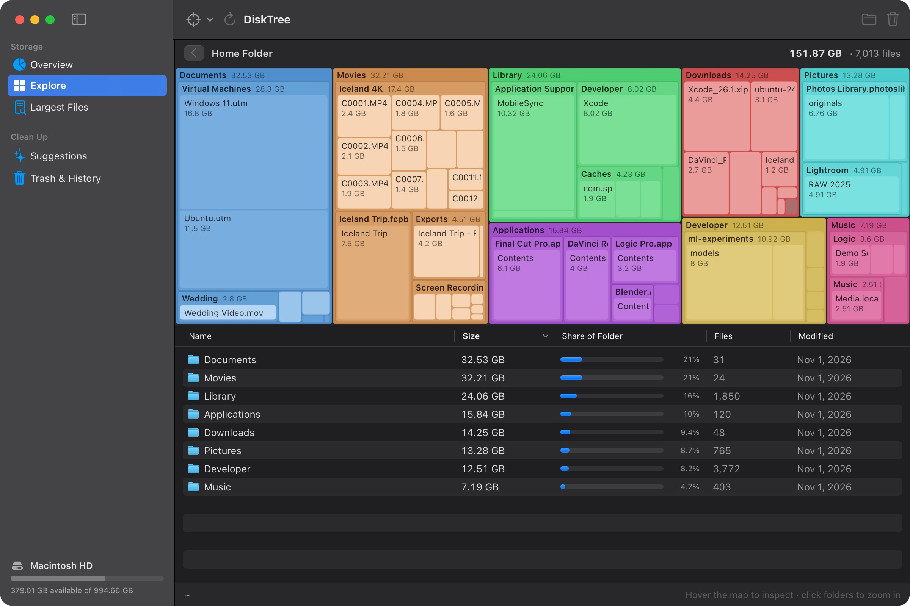
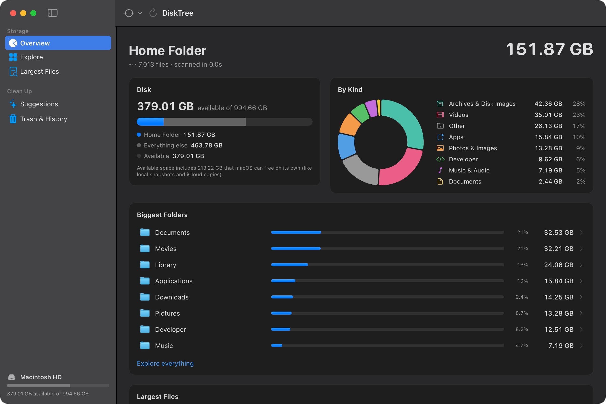
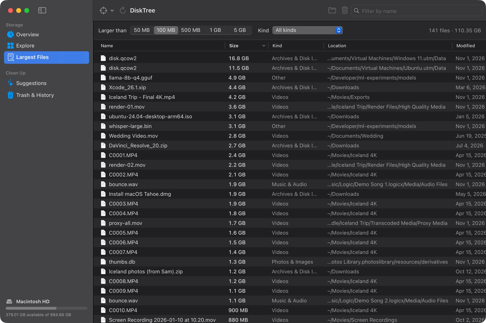
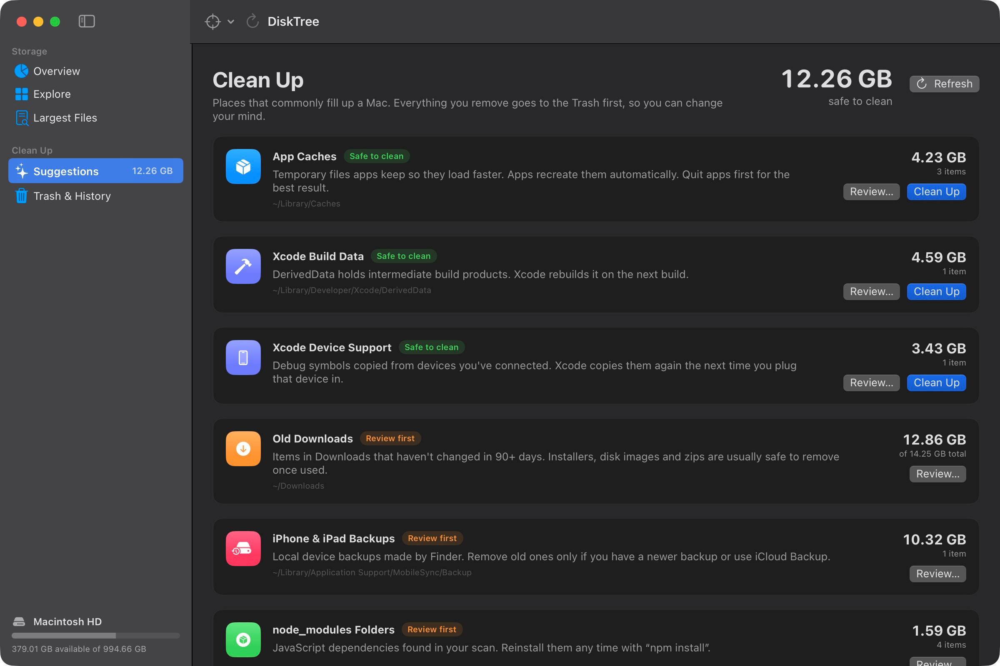

# DiskTree

<p align="center">
  
</p>

<p align="center"><b>Free up space on your Mac.</b><br>A native disk space analyzer that maps your storage as a treemap, finds your largest files, and cleans up safely.</p>

<p align="center">
  <a href="https://github.com/alx-kap/DiskTree/releases/latest/download/DiskTree.zip"><b>Download for macOS</b></a> ·
  <a href="https://alx-kap.github.io/DiskTree/">Website</a> ·
  macOS 14+ · Apple silicon &amp; Intel · Free and open source
</p>

<p align="center">
  
</p>

"Your disk is almost full." Then you open System Settings and half of it is a gray bar called *System Data*. DiskTree shows you what's actually there: every folder drawn to scale, so the 40 GB iPhone backup from three phones ago and the Xcode build folder you forgot about are impossible to miss. Then it helps you clear them out without breaking anything.

## What it does

- **See everything at once.** A zoomable treemap of any folder, disk or external drive. Big blocks are big files. Click a folder to dive in.
- **Find the space hogs.** A sortable list of every file over 50 MB, filterable by kind: videos, disk images, apps, developer files and more.
- **One-click cleanup, with judgment.** DiskTree checks the places that quietly fill up a Mac and labels each one honestly:
  - *Safe to clean:* app caches, log files, Xcode DerivedData and device support files, Simulator caches, npm/pnpm/Gradle/Cargo caches
  - *Review first:* old downloads (untouched for 90+ days), iPhone and iPad backups, Xcode archives, `node_modules` folders
  - *Good to know:* Simulator devices and the Trash
- **Undo anything.** Nothing is deleted outright. Items go to the Trash, and *Trash & History* lets you put them back where they were.
- **Hard to misuse.** DiskTree refuses to touch system locations, standard folders like Documents or Library, the insides of apps and Photos libraries, and your keychains. It warns you before removing iCloud files, app data or device backups.
- **Fast and private.** Scans run on several threads using bulk directory reads, never follow symlinks or cross onto other drives, and never download iCloud files that aren't stored locally. Nothing ever leaves your Mac: no network access, no analytics, no account.

## Screenshots

| Overview | Largest files | Clean up |
|---|---|---|
|  |  |  |

## Install

### Option 1: Download the app

1. Download [`DiskTree.zip`](https://github.com/alx-kap/DiskTree/releases/latest/download/DiskTree.zip) from the [latest release](https://github.com/alx-kap/DiskTree/releases/latest) and unzip it.
2. Drag **DiskTree.app** into your Applications folder.
3. Open it. The first time, macOS says it can't verify the app, because DiskTree isn't notarized by Apple (that needs a paid developer account, and this is a free open-source project). To allow it, **right-click DiskTree.app › Open › Open**, or go to **System Settings › Privacy & Security** and click **Open Anyway**.

Or do it all with one line in Terminal:

```bash
curl -fsSL https://alx-kap.github.io/DiskTree/install.sh | bash
```

That downloads the latest release into `~/Applications`, clears the quarantine flag and opens the app. [Read the script](docs/install.sh) first if you like; it's 15 lines.

### Option 2: Build it yourself

You need Swift 5.9 or later, which comes with Xcode or the Command Line Tools (`xcode-select --install`). There are no third-party dependencies.

```bash
git clone https://github.com/alx-kap/DiskTree.git
cd DiskTree
./install.sh
```

That builds a release copy into `~/Applications/DiskTree.app` and opens it. Run it again any time to update. Because you built it yourself, macOS doesn't show the security warning.

### Using an AI agent?

Point it at this repo and say "install DiskTree". [AGENTS.md](AGENTS.md) has exact steps.

## Getting started

1. Open DiskTree. It asks for two optional permissions: access to Desktop, Documents and Downloads so they can be measured, and permission to control Finder so it can empty the Trash for you. You can change either later from **DiskTree › Permissions…**
2. Choose **Home Folder** (the best place to start), **Entire Disk**, or **Choose Folder…** for any folder or external drive.
3. Explore the map, check **Largest Files**, or go straight to **Suggestions** to see what's safe to clean.

| Action | Shortcut |
|---|---|
| Scan home folder | `⌘1` |
| Scan entire disk | `⌘2` |
| Scan Applications | `⌘3` |
| Scan a folder | `⌘O` |
| Rescan | `⌘R` |
| Move selection to the Trash | `Delete` |

## How it's built

DiskTree is a SwiftUI app with no dependencies, packaged with Swift Package Manager.

```
DiskTree/
  Package.swift
  build.sh                  Builds DiskTree.app (pass --universal for arm64 + x86_64)
  Sources/DiskTree/
    Scanner.swift           Multithreaded getattrlistbulk(2) walker
    Treemap.swift           Squarified treemap layout and rendering
    Safety.swift            Rules for what may and may not be moved to the Trash
    CleanupStore.swift      Cleanup categories and how they're measured
    ...                     Views: Overview, Explore, Largest Files, Clean Up, Trash & History
  Support/                  Info.plist and the icon generator
install.sh                  Build from source and install to ~/Applications
release.sh                  Build dist/DiskTree.zip for a GitHub release
docs/                       The website (GitHub Pages)
```

## FAQ

**Is it really free?**
Yes. DiskTree is MIT-licensed, with no trial, no subscription and no "upgrade to delete" button.

**Will it delete things by itself?**
No. It only moves what you choose to the Trash, and you can put items back from *Trash & History* until the Trash is emptied.

**What about "System Data"?**
Much of what macOS lumps into System Data lives in your home folder's Library: caches, logs, device backups, Xcode and Simulator files. Scan your home folder and DiskTree shows exactly which of those are taking up room. Space macOS can free on its own, like local snapshots, is shown separately.

**Does it need Full Disk Access?**
No. Without it, macOS hides a few protected folders (such as Mail and Messages data) and the contents of the Trash. Everything else scans normally, and DiskTree tells you when something couldn't be read.

**How is it different from DaisyDisk, GrandPerspective or OmniDiskSweeper?**
DiskTree is a free, open-source alternative that combines the visual map with guided cleanup and an undo history, and it knows about developer clutter like DerivedData, Simulator caches and `node_modules`.

## Contributing

Issues and pull requests are welcome. If you find a folder that regularly fills up Macs and isn't covered, open an issue.

## License

[MIT](LICENSE)

---

<sub>Keywords: free up space on Mac, Mac storage full, disk space analyzer for macOS, disk usage visualizer, treemap, what is taking up space on my Mac, System Data, clear cache Mac, Xcode DerivedData cleanup, node_modules cleanup, free DaisyDisk alternative, open-source Mac cleaner, SwiftUI.</sub>
